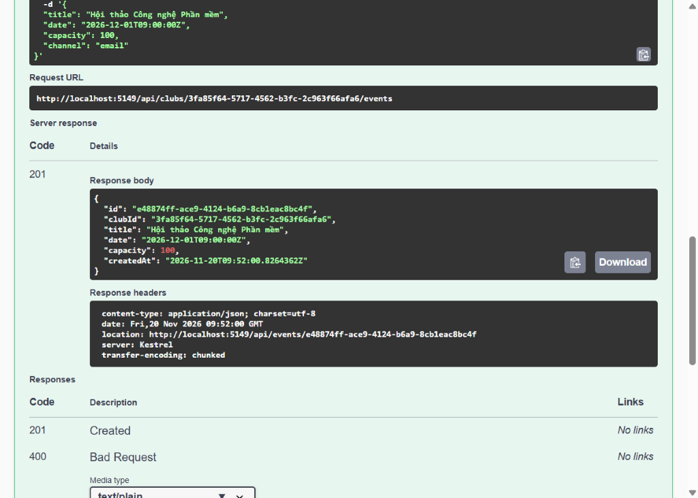
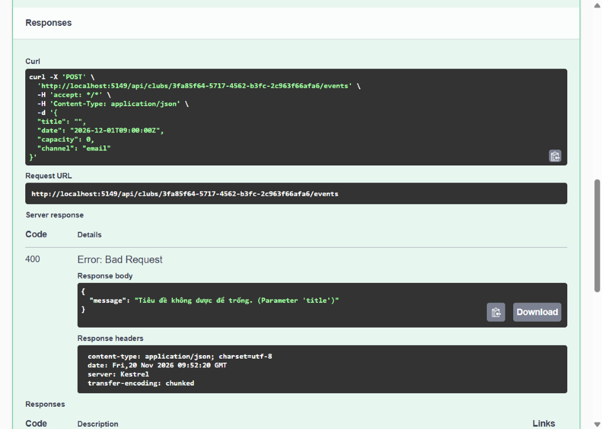

# Minh chứng thực hiện Swagger API

Thư mục chứa ảnh chụp màn hình kiểm thử trực tiếp trên Swagger UI tại http://localhost:5149/swagger:

1. **Gọi thành công (HTTP 201 Created):**
   - Route: POST /api/clubs/{clubId}/events
   - Dữ liệu hợp lệ: 	itle = "Hội thảo Công nghệ Phần mềm", capacity = 100.
   - Kết quả: Tạo sự kiện thành công với status 201 Created.
   - Minh chứng: 

2. **Gọi lỗi (HTTP 400 Bad Request):**
   - Route: POST /api/clubs/{clubId}/events
   - Dữ liệu không hợp lệ: 	itle = "" (rỗng), capacity = 0.
   - Kết quả: Ném ArgumentException và trả về status 400 Bad Request kèm thông báo lỗi.
   - Minh chứng: 
