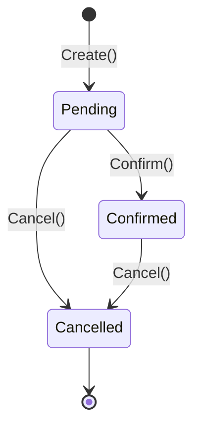

# BÀI LÀM ĐỀ SỐ 02 — HỌC PHẦN IN4211
**Sinh viên:** Bùi Trung Tín  
**MSSV:** 0024416184  
**Lớp học phần:** Phát triển phần mềm hướng đối tượng (IN4211)  
**Giảng viên:** ThS. Nguyễn Tuấn Kiệt  

---

## Câu 1a
Bốn trụ cột của lập trình hướng đối tượng (OOP):

1. **Đóng gói (Encapsulation):**
   - *Giải thích:* Gom nhóm dữ liệu (thuộc tính) và hành vi (phương thức) vào trong cùng một đơn vị (lớp), đồng thời ẩn giấu trạng thái nội bộ bằng các phạm vi truy cập (`private`, `protected`), chỉ cho phép truy cập hay thay đổi thông qua các phương thức nghiệp vụ hợp lệ nhằm bảo vệ tính toàn vẹn dữ liệu.
   - *Minh hoạ trong bài:* Lớp `Member` trong tệp `EduHub.Domain/Entities/Member.cs` (và `Registration` trong `EduHub.Domain/Entities/Registration.cs`), các thuộc tính có `private set`, constructor `private` và trạng thái chỉ được khởi tạo qua factory method `Create(...)` có kiểm tra hợp lệ.

2. **Kế thừa (Inheritance):**
   - *Giải thích:* Cho phép một lớp dẫn xuất (lớp con) tái sử dụng lại các đặc tính, thuộc tính và hành vi của lớp cơ sở (lớp cha), thiết lập mối quan hệ "is-a" và giúp giảm thiểu việc lặp lại mã nguồn.
   - *Minh hoạ trong bài:* Lớp `EventsController` kế thừa lớp cha `ControllerBase` trong tệp `EduHub.API/Controllers/EventsController.cs` để sử dụng lại các phương thức tiện ích HTTP như `Ok()`, `NotFound()`, `CreatedAtAction()`.

3. **Đa hình (Polymorphism):**
   - *Giải thích:* Khả năng các đối tượng thuộc các lớp khác nhau có thể phản hồi cùng một lời gọi phương thức theo những cách riêng biệt thông qua việc hiện thực hoá interface hoặc ghi đè phương thức.
   - *Minh hoạ trong bài:* Hai lớp `EmailNotificationService` (tệp `EduHub.Infrastructure/Services/EmailNotificationService.cs`) và `SmsNotificationService` (tệp `EduHub.Infrastructure/Services/SmsNotificationService.cs`) cùng cài đặt interface `INotificationService`. Lớp `EventService` chỉ cần gọi `_notificationService.Send(...)`, tại thời điểm chạy phương thức tương ứng của từng kênh sẽ được kích hoạt đa hình.

4. **Trừu tượng (Abstraction):**
   - *Giải thích:* Tập trung vào việc thể hiện các hành vi và hợp đồng cốt lõi của đối tượng ra bên ngoài, giấu đi các chi tiết cài đặt kỹ thuật phức tạp bên dưới, thường được định nghĩa qua interface hoặc abstract class.
   - *Minh hoạ trong bài:* Interface `IEventRepository` trong tệp `EduHub.Domain/Interfaces/IEventRepository.cs` (hoặc `INotificationService` trong `EduHub.Application/Interfaces/INotificationService.cs`), định nghĩa các thao tác lưu trữ mà không phụ thuộc vào chi tiết cài đặt là lưu trữ trong bộ nhớ (InMemory) hay cơ sở dữ liệu SQL.

## Câu 1b
Hai vấn đề về đóng gói của lớp `Member` trong đoạn mã đề bài:
1. **Sử dụng public setter (`public Guid Id { get; set; }`, `public string Email { get; set; }`):** Cho phép bất kỳ đoạn mã nào bên ngoài đối tượng cũng có thể trực tiếp sửa đổi dữ liệu tùy tiện mà không qua cơ chế kiểm tra (validation), phá vỡ tính toàn vẹn của dữ liệu (ví dụ: dòng 9 gán `m.Email = "abc"` không hợp lệ vẫn bị lưu).
2. **Cung cấp constructor mặc định public không tham số (`public Member() { }`):** Cho phép khởi tạo đối tượng `Member` ở trạng thái rỗng hoặc không hợp lệ (Id là `Guid.Empty`, Email mang giá trị rỗng/null) mà không bắt buộc phải truyền vào các thông tin hợp lệ ngay khi tạo.

## Câu 2a
Sơ đồ trạng thái của `Registration` bằng Mermaid (`stateDiagram-v2`):

- Phiếu mới được tạo bằng `Registration.Create(...)` sẽ ở trạng thái khởi đầu là `Pending`.
- Từ `Pending`, gọi `Confirm()` chuyển sang `Confirmed`, hoặc gọi `Cancel()` chuyển sang `Cancelled`.
- Từ `Confirmed`, gọi `Cancel()` chuyển sang `Cancelled`.
- Khi đã ở `Cancelled`, phiếu không thể thực hiện bất kỳ chuyển đổi trạng thái nào khác (mọi thao tác `Confirm()` hay `Cancel()` tiếp theo đều ném `InvalidOperationException`).

## Câu 3a
Ba nguyên lý SOLID mà lớp `EventService` ban đầu vi phạm:

1. **SRP (Single Responsibility Principle - Nguyên lý Đơn trách nhiệm):**
   - *Dòng vi phạm:* Dòng 6–14 (cụ thể: dòng 6–7 kiểm tra hợp lệ, dòng 8–9 kết nối CSDL và ghi dữ liệu, dòng 10 ghi file log vật lý, dòng 11–14 xử lý gửi thông báo).
   - *Giải thích:* Lớp `EventService` gánh vác quá nhiều lý do để thay đổi: vừa xác thực dữ liệu, vừa thao tác trực tiếp với cơ sở dữ liệu, vừa ghi nhật ký ra file cục bộ, vừa định tuyến và gửi thông báo. Thay đổi ở bất kỳ khâu nào (đổi cách ghi log, đổi hệ quản trị CSDL, đổi cơ chế thông báo) đều buộc phải sửa lớp này.

2. **OCP (Open/Closed Principle - Nguyên lý Đóng/Mở):**
   - *Dòng vi phạm:* Dòng 11–14 (`if (channel == "email") ... else if (channel == "sms") ...`).
   - *Giải thích:* Lớp không đóng với sửa đổi và không mở với mở rộng. Khi muốn bổ sung một kênh gửi thông báo mới (ví dụ Zalo, Telegram, Push Notification), ta bắt buộc phải can thiệp và sửa đổi trực tiếp vào thân mã nguồn của phương thức `CreateEvent`, làm tăng rủi ro gây lỗi trên các kênh đang chạy ổn định.

3. **DIP (Dependency Inversion Principle - Nguyên lý Đảo ngược Phụ thuộc):**
   - *Dòng vi phạm:* Dòng 8 (`new SqlConnection(...)`), dòng 12 (`new EmailSender()`), dòng 14 (`new SmsSender()`).
   - *Giải thích:* Module cấp cao (`EventService`) phụ thuộc trực tiếp vào các chi tiết cụ thể cấp thấp (`SqlConnection`, `EmailSender`, `SmsSender`) thay vì phụ thuộc vào abstraction (interface). Điều này gây ra liên kết chặt (tight coupling), khiến mã nguồn khó mở rộng, không thể thay thế linh hoạt và không thể viết unit test độc lập do luôn dính chặt vào CSDL và các sender thực tế.

## Câu 4b
Phân biệt `git merge` và `git rebase`:

| Tiêu chí | `git merge` | `git rebase` |
| :--- | :--- | :--- |
| **Cơ chế hoạt động** | Kết hợp các nhánh lại với nhau bằng cách tạo ra một **commit gộp mới (merge commit)** có hai commit cha. | Đặt lại điểm gốc của nhánh hiện tại lên đỉnh của nhánh đích, sau đó áp dụng lần lượt từng commit lên đó (tạo ra các commit mới với SHA mới). |
| **Lịch sử commit** | Giữ nguyên vẹn toàn bộ lịch sử nhánh cũ theo đúng trình tự thời gian; lịch sử có dạng đồ thị phân nhánh (non-linear). | Lịch sử được viết lại thành một đường thẳng tắp, liên tục và gọn gàng (linear history), không sinh ra merge commit phụ. |
| **Tính an toàn** | Rất an toàn, không thay đổi các commit đã có trong quá khứ. | Thay đổi mã SHA và viết lại lịch sử commit. |

**Khi nào không nên dùng rebase (Quy tắc vàng của Git Rebase):**
- **Không bao giờ rebase trên các nhánh công khai/dùng chung (public/shared branches)** như `main`, `master`, `develop` hoặc các nhánh đang có nhiều thành viên khác cùng kéo về và làm việc.
- *Lý do:* Vì rebase sẽ tạo ra các mã băm commit mới và viết lại lịch sử. Nếu ai đó đã pull các commit cũ về máy và tiếp tục phát triển dựa trên đó, việc rebase rồi force push (`push --force`) sẽ làm phân mảnh lịch sử, gây ra xung đột hàng loạt rất phức tạp và khó phục hồi đối với các thành viên trong nhóm.
